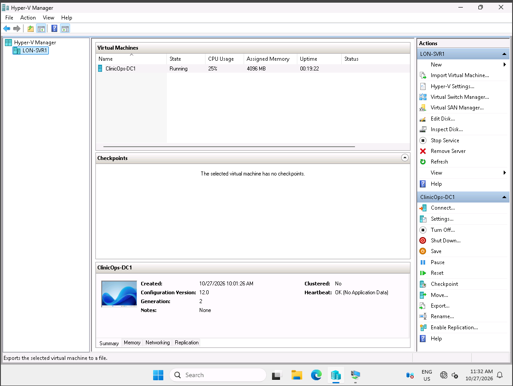
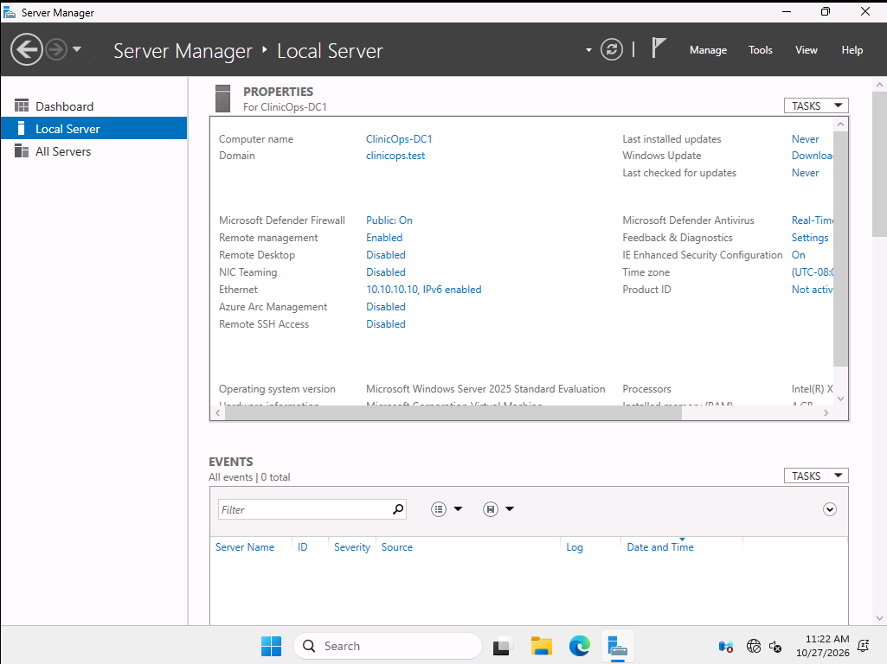
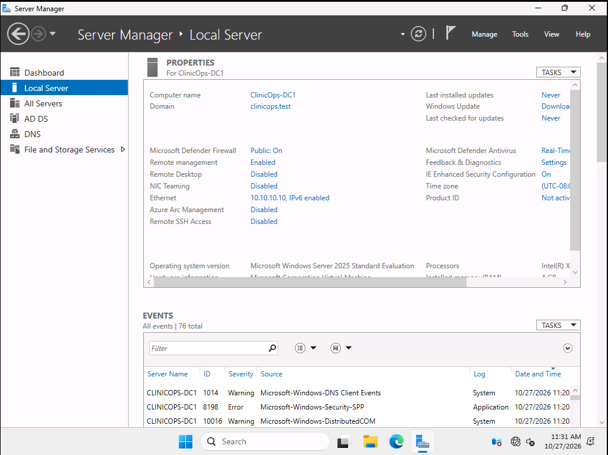
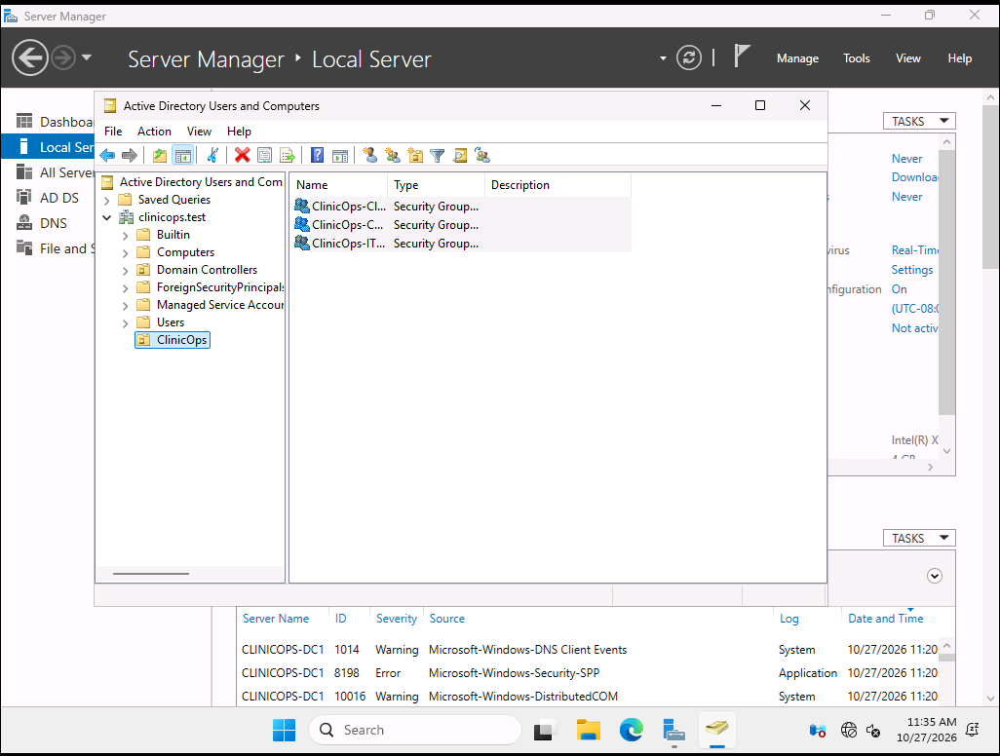
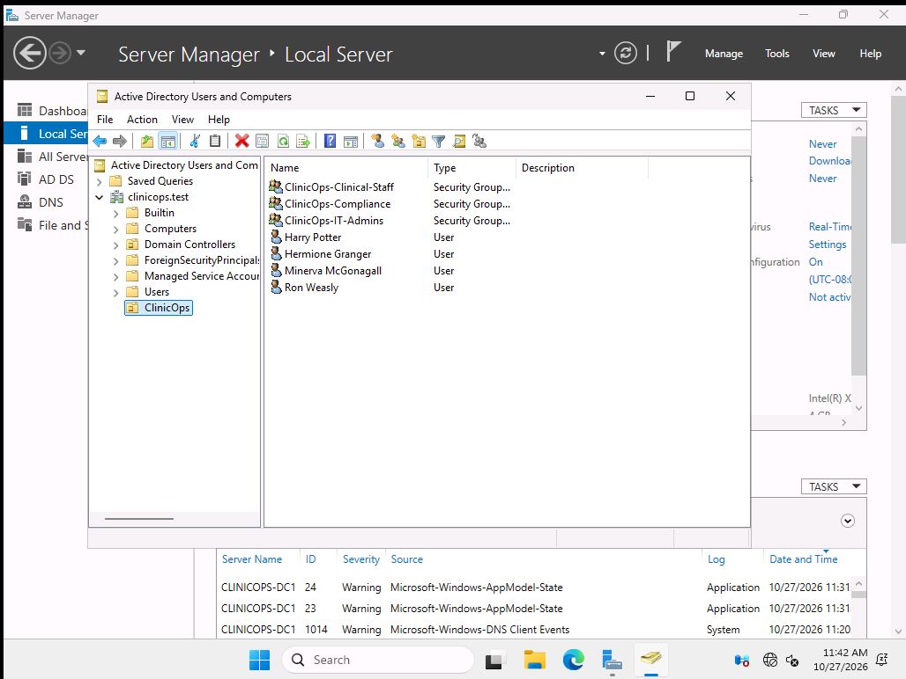
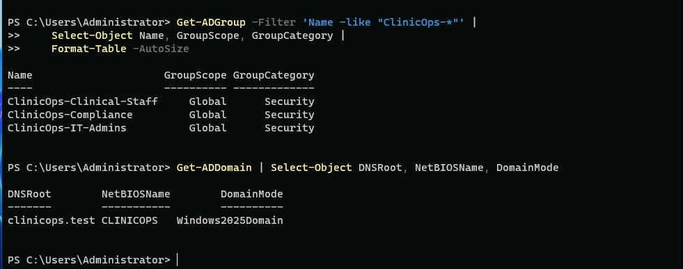
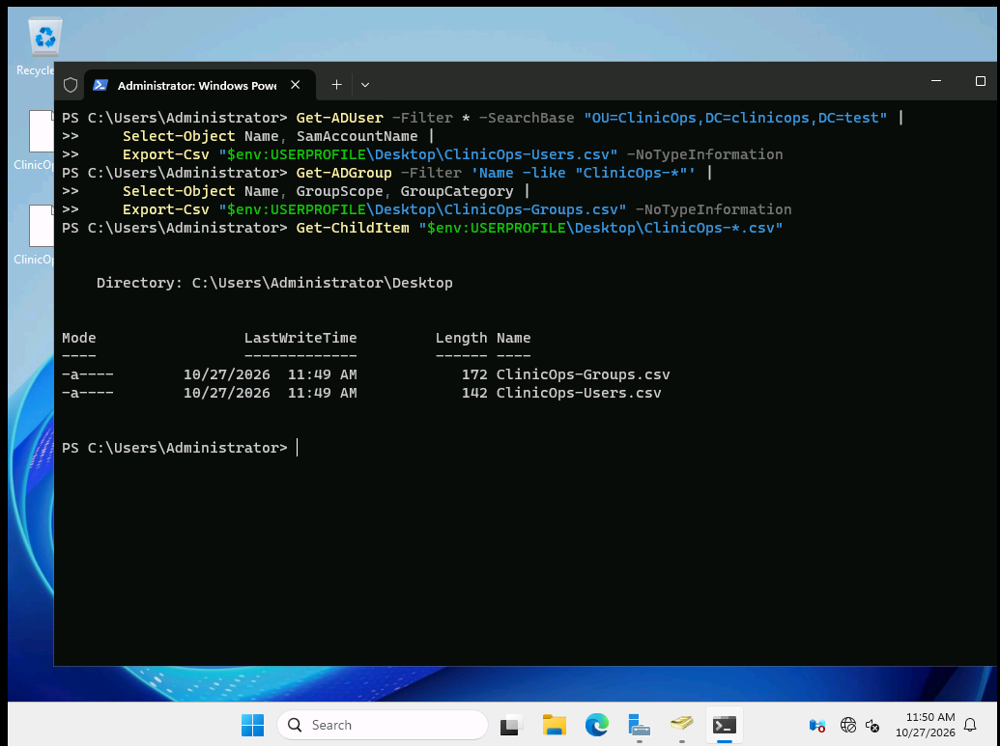
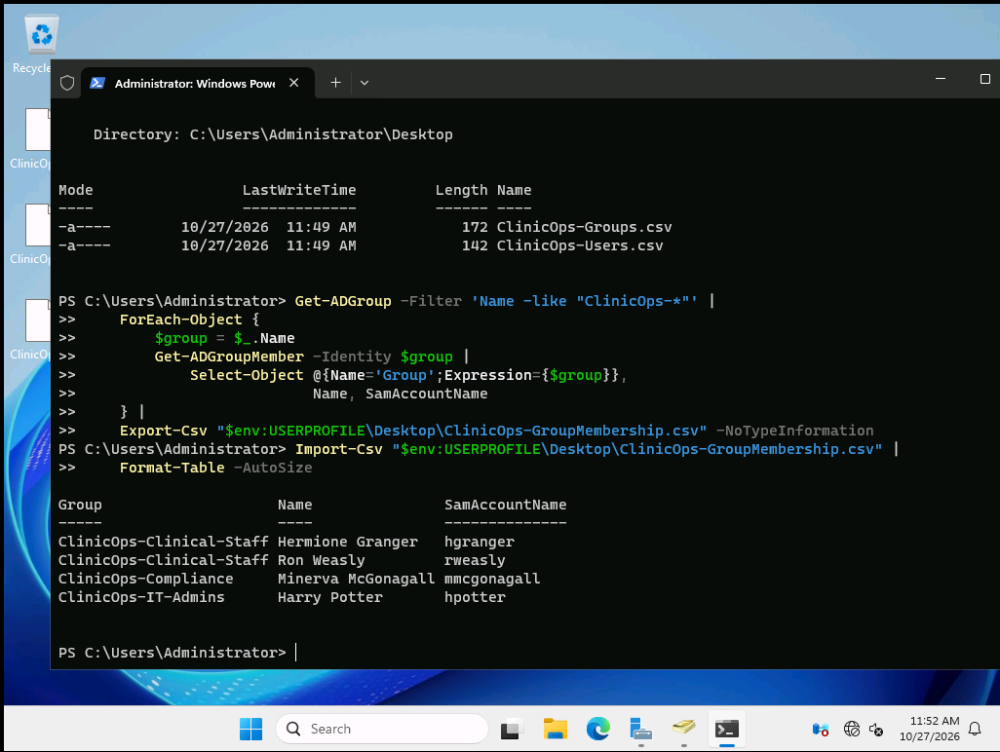
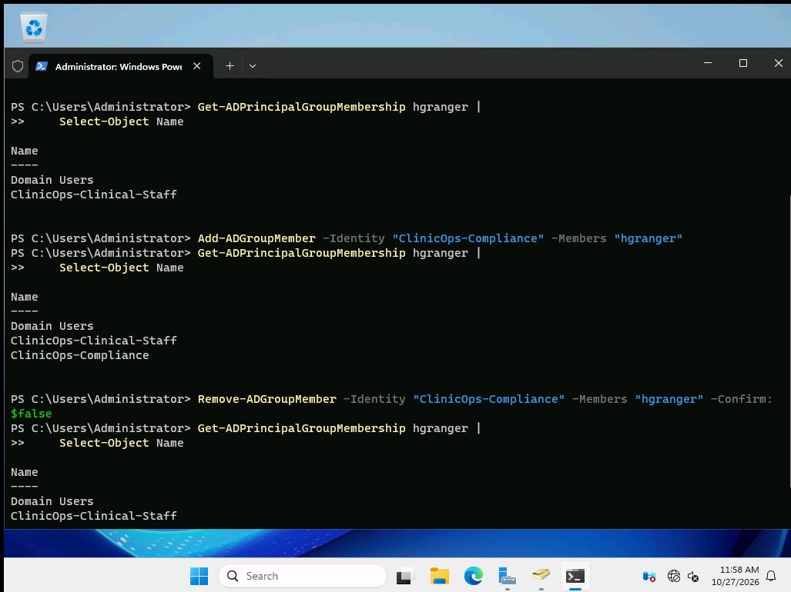
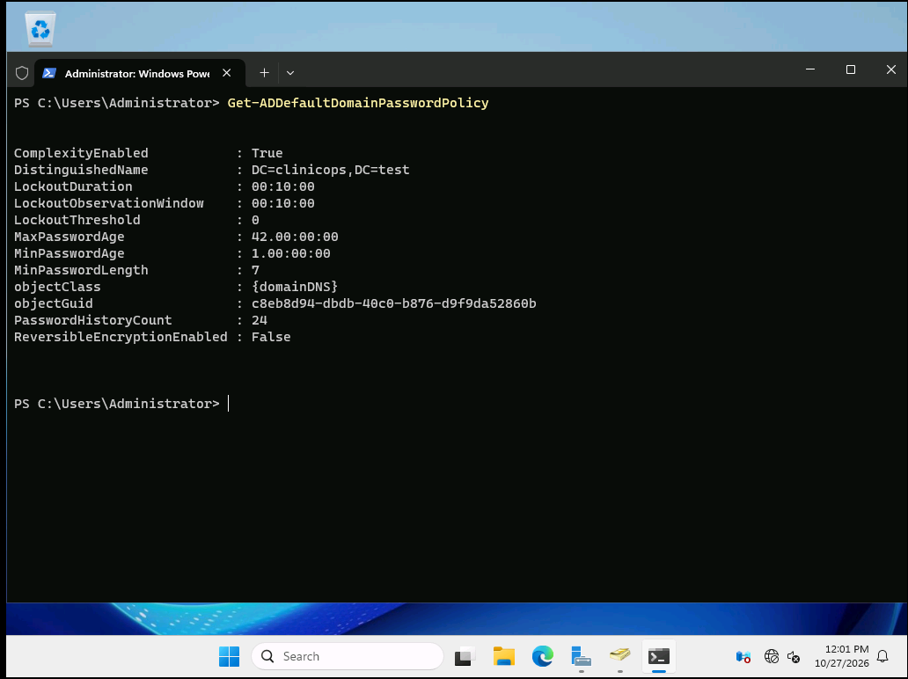

Phase-1-Documentation.md

# ClinicOps – Phase 1 Documentation
## Hyper-V Environment Setup and Active Directory Deployment

### 1. Project Overview

Phase 1 focused on building the foundation for ClinicOps, a fictional healthcare IT environment. The goal was to deploy a Windows Server domain controller, establish an isolated Active Directory domain, organize users and security groups, and verify the configuration using graphical administration tools and PowerShell.

The lab uses fictional healthcare staff accounts and contains no real patient information or protected health information (PHI).

### 2. Lab Environment

The environment was built using a Windows Server 2025 virtual machine created with Hyper-V Manager in the existing MSSA Hyper-V lab environment. My personal computer did not support the required Hyper-V setup, so I used the virtual lab environment provided through MSSA.

**Environment configuration**

- Server: `ClinicOps-DC1`
- Operating system: Windows Server 2025 Standard Evaluation (Desktop Experience)
- Virtualization: Microsoft Hyper-V
- Virtual machine generation: Generation 2
- Memory: 4 GB
- Virtual processors: 2
- Virtual hard disk: 80 GB
- Network: Private virtual switch
- Domain: `clinicops.test`
- NetBIOS name: `CLINICOPS`
- Static IP address: `10.10.10.10/24`
- DNS server: `10.10.10.10`

The private network isolated the ClinicOps environment from external networks. The server used its own static IP address and DNS configuration for the domain environment.

### 3. Virtual Machine and Windows Server Setup

Created the `ClinicOps-DC1` virtual machine using Hyper-V Manager. Configured the virtual machine's memory, processor, virtual hard disk, network connection, and Windows Server installation media.

Installed Windows Server 2025 Standard Evaluation with Desktop Experience and configured the server name and network settings.

**Server configuration**

The server was configured as `ClinicOps-DC1` and prepared for its role as the domain controller.

### 4. Active Directory Domain Services and DNS

Installed the Active Directory Domain Services (AD DS) and DNS Server roles in preparation for creating the ClinicOps domain.

Promoted the server to a domain controller and created a new Active Directory forest using the domain name `clinicops.test`. This established the directory services environment used to manage the fictional healthcare organization’s users, groups, and access.

### 5. Organizational Unit and Security Groups

Created a dedicated `ClinicOps` organizational unit (OU) to keep the lab's accounts and security groups organized. Enabled protection against accidental deletion for the OU.

Created three Global Security groups to represent different job functions and access needs:

- `ClinicOps-Clinical-Staff`
- `ClinicOps-IT-Admins`
- `ClinicOps-Compliance`

### 6. User Account Creation and Group Assignment

Created four fictional user accounts to represent different roles in the healthcare environment:

| User | Username | Assigned security group |
|---|---|---|
| Hermione Granger | `hgranger` | ClinicOps-Clinical-Staff |
| Harry Potter | `hpotter` | ClinicOps-IT-Admins |
| Ron Weasley | `rweasley` | ClinicOps-Clinical-Staff |
| Minerva McGonagall | `mmcgonagall` | ClinicOps-Compliance |

Assigned each account to its corresponding security group to establish role-based organization within Active Directory.

### 7. Active Directory Verification with PowerShell

Used PowerShell and the Active Directory module to verify the domain configuration and retrieve information about the ClinicOps security groups and user accounts.

Commands included:

- `Get-ADDomain` to inspect domain information.
- `Get-ADGroup` to retrieve security group details.
- `Get-ADUser` to inspect user accounts.
- `Get-ADGroupMember` to verify group membership.

These commands provided a way to inspect directory information and confirm that the domain, groups, and accounts were configured as expected.

### 8. Exporting Active Directory Information

Used PowerShell to export user, group, and group membership information into CSV files. Verified the exported files so the directory information could be reviewed outside Active Directory.

The exports included:

- `ClinicOps-Users.csv`
- `ClinicOps-Groups.csv`
- `ClinicOps-GroupMembership.csv`

### 9. Group Membership Verification and Changes

Verified that the fictional users were assigned to their intended security groups. Also tested the process of temporarily adding a user to another group, removing that membership, and confirming that the original membership was restored.

This demonstrated how group membership can be managed and verified using Active Directory and PowerShell.

### 10. Domain Password Policy Review

Used PowerShell to inspect the domain's default password policy, including password length, complexity, and account lockout settings.

This provided visibility into the domain's existing password policy configuration without requiring changes to the policy.

### 11. Phase 1 Results and Skills Demonstrated

Completed the initial ClinicOps domain environment and verified the core Active Directory configuration.

**Skills demonstrated**

- Hyper-V virtual machine creation and configuration
- Windows Server 2025 installation and administration
- Static IP and DNS configuration
- Active Directory Domain Services deployment
- Domain controller and forest creation
- Organizational Unit administration
- Active Directory user and security group management
- Role-based group membership
- PowerShell directory queries and verification
- CSV exports and basic directory reporting
- Domain password policy inspection

### 12. Architecture Reference

The Phase 1 architecture document and diagram provide a visual overview of the environment and its configuration.

See [Phase 1 Architecture](01-Architecture/Phase-1-Architecture.md) and the [ClinicOps Phase 1 Architecture Diagram](01-Architecture/ClinicOps%20Phase%201%20Architecture%20Diagram.png).

---

**Phase 1 Status: Complete**

Phase 1 established the ClinicOps Active Directory environment. Phase 2 expanded the project by creating and managing identities in a dedicated OU within the existing MSSA training domain, configuring file-share and NTFS permissions, testing role-based access, and investigating Windows security audit events.
